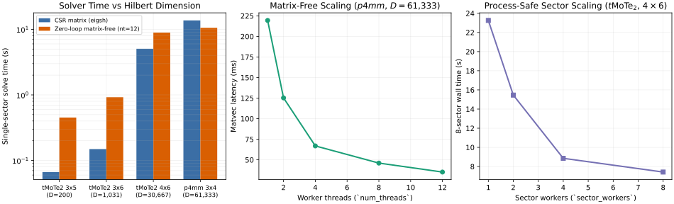
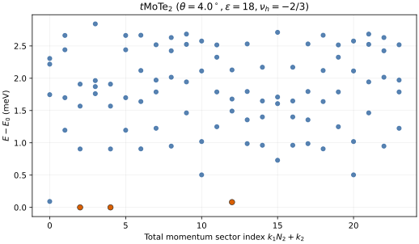
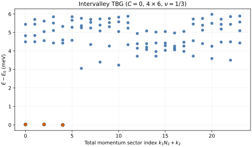
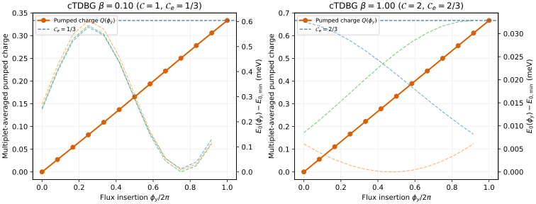
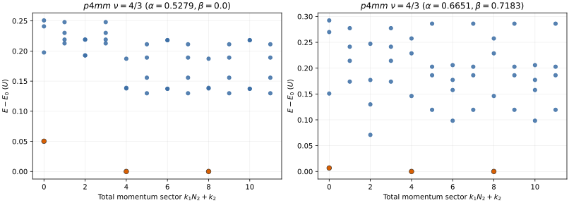

# BandProjected_ExactDiagonalization

A clean, general, high-performance **pure-NumPy / SciPy** exact diagonalization engine for **momentum-space projected multi-band fermionic models** on 2D rectangular and sheared/tilted Bravais tori. Designed with zero `numba` dependencies by combining bitwise Fock arithmetic, meet-in-the-middle sector enumeration, momentum-blocked intermediate-state BLAS-3 (`ZGEMM`) matrix-free kernels, and ARPACK-safe multi-process sector parallelism.

---

## Key Capabilities

- **Arbitrary Torus Geometries via Smith Normal Form (`lattice.py`)**: Supports primitive diagonal supercells $(N_1, N_2)$ and arbitrary $2\times 2$ integer supercell matrices $\mathbf{N}$ (e.g. tilted 24-cell $\begin{pmatrix}5 & 1 \\ 1 & 5\end{pmatrix} \sim \begin{pmatrix}1 & 5 \\ 0 & 24\end{pmatrix}$), reducing crystal momenta canonically via $U \mathbf{N} V = \operatorname{diag}(d_1, d_2)$ while tracking exact Umklapp reciprocal windings.
- **Arbitrary Internal Degrees of Freedom (`bloch.py`)**: Uniform `BlochBand` and `InternalSpace` interface for isolated or multi-band manifolds carrying band, valley, sublattice, or spin indices, with exact zero-padded 2D FFT batch form factors, non-Abelian Fukui–Hatsugai–Suzuki Chern numbers, gauge-invariant Fubini–Study quantum geometry, and exact Fock-space particle-hole transformation (`particle_hole_transform`).
- **General Two-Body Interactions (`interaction.py`)**: Construct `BandProjectedHamiltonian` from Bloch form factors + arbitrary $V(\bm q)$ (`from_band`, `from_potential`) or an explicit four-fermion tensor $V_{ijkl}$ (`from_four_fermion_tensor`). Built-in `bare_coulomb`, `dual_gate_coulomb`, and `haldane_pseudopotential_v1`.
- **High-Speed Pure-NumPy ED Solvers (`basis.py`, `solver.py`)**:
  - `MomentumSectorCatalog`: meet-in-the-middle half-bit enumeration up to 63 orbitals without ever materializing the full $\binom{N_{\text{orb}}}{N_e}$ Fock space.
  - Upper-triangle-only Hermitian sparse CSR assembly (`mode="matrix"`) with branch-free vectorized Jordan–Wigner signs (`parity_sign_u64`).
  - Zero-loop 6-kernel intermediate-state BLAS-3 `ZGEMM` + `np.bincount` matrix-free operator (`mode="matrixfree"`), cutting peak memory by **5.1x** at $D = 61{,}333$.
  - `sector_workers` process-pool parallelism (safe for non-reentrant Fortran ARPACK) with atomic checkpoint/resume.
- **Many-Body Topological & Correlation Diagnostics (`observables.py`)**:
  - Warm-started **1D Resta–Thouless charge pump** (`resta_polarization_matrix`, `thouless_charge_pump_1d`) and **2D FHS many-body Chern number & Wilson pumps** (`many_body_chern_number_and_pump`).
  - Momentum-resolved 1-RDM (`occupation_matrix`), connected static structure factor $S(\bm q)$ (`static_structure_factor_sector`), particle entanglement spectrum (`particle_entanglement_spectrum`), flux spectral flow, and `.svg`-only plotting (`plot_ed_spectrum`).
- **Built-in Model Gallery (`models/`)**: `TorusLLL` / `haldane_v1_hamiltonian`, `TMDContinuum` ($t\mathrm{MoTe}_2$), `ChiralTDBG` ($C=2$), `IntervalleyTBG` ($C=0$), and `P4MMStrainModel` (vortexable two-band $p4mm$ along magic lines).

---

## Installation & Quick Start

```bash
# Editable install (NumPy >= 2.0, SciPy >= 1.13, Matplotlib >= 3.8)
pip install -e .
```

### Example: Twisted MoTe$_2$ at $\nu_h = -2/3$ and 1D Charge Pump

```python
from bandprojected_exactdiagonalization import BandProjectedED, thouless_charge_pump_1d
from bandprojected_exactdiagonalization.models import ChiralTDBG, TMDContinuum

# 1. Single-valence band tMoTe2 (arXiv:2304.11864 default: theta = 3.89 deg, eps = 15.0, 4x6 torus)
model = TMDContinuum()
partner, ham, e_full, _ = model.hole_partner_hamiltonian(supercell=(4, 6), qell_cutoff=7.5)
ed = BandProjectedED(ham, n_particles=8)
scan = ed.scan_sectors(nev=4, mode="matrix", sector_workers=8)
print("Ground energy (electron partner):", scan["ground_energy"])

# 2. Verify cTDBG Hall transition C_e = 1/3 -> 2/3 via 1D Resta-Thouless pump
pump = thouless_charge_pump_1d(
    lambda tw: ChiralTDBG(beta=1.0, cutoff=4.0).hamiltonian((4, 6), qell_cutoff=6.0, twists=tw),
    n_particles=8,
    n_steps=12,
    flux_axis=1,
    manifold_size=3,
    sectors=[(0, 0), (0, 2), (0, 4)],
    nev=2,
    mode="matrix",
    sector_workers=3,
)
print(f"Pumped total Chern = {pump['integer_chern']}, sigma_xy = {pump['averaged_hall_conductivity']:.4f}")
```

---

## Performance Benchmarks (Pure NumPy, Zero Numba)

Measured on dual-socket EPYC node (`OPENBLAS_NUM_THREADS=1 OMP_NUM_THREADS=1`), comparing single-sector CSR `eigsh` (`mode="matrix"`) against the zero-loop 6-kernel `ZGEMM + bincount` matrix-free solver (`mode="matrixfree"`, `num_threads=12`) via [`benchmark/benchmark.py`](benchmark/benchmark.py):

| System / Torus | Sector Dim $D$ | CSR Time (s) | Matrix-Free Time (s) | CSR Peak RAM (MB) | Matrix-Free Peak RAM (MB) |
| --- | ---: | ---: | ---: | ---: | ---: |
| $t\mathrm{MoTe}_2$ $3\times 5$, $N_e=5$ | 201 | 0.072 | 0.420 | 0.50 | 0.36 |
| $t\mathrm{MoTe}_2$ $3\times 6$, $N_e=6$ | 1,032 | 0.136 | 0.788 | 4.14 | 2.21 |
| $t\mathrm{MoTe}_2$ $4\times 6$, $N_e=8$ | 30,709 | 4.028 | 7.334 | 299.74 | 73.45 |
| Two-band $p4mm$ $3\times 4$, $N_h=8$ | 61,333 | 10.181 | 10.844 | 1220.39 | **240.91** |

- **Thread scaling on $p4mm$ ($D=61{,}333$)**: single-matvec latency drops from `214.8 ms` (`nt=1`) to `34.2 ms` (`nt=12`) — a **6.29x** speedup without leaving pure NumPy/SciPy.
- **Process-pool sector scaling on $t\mathrm{MoTe}_2$ $4\times 6$ (8 sectors)**: wall time drops from `24.59s` (`sector_workers=1`) to `8.40s` (`sector_workers=8`).



---

## Model Validation Gallery

| $t\mathrm{MoTe}_2$ Evolution ($\theta=3.89^\circ,\epsilon=15 \to \theta=4.0^\circ,\epsilon=18$, $4\times 6$) | $C=0$ icTBG ($4\times 6$, gap $3.031\ \text{meV}$) |
| :---: | :---: |
|  |  |

| Chiral TDBG $\beta=0.1 \to 1.0$ 1D Charge Pump ($\mathcal{C}_e: 1/3 \to 2/3$) | Vortexable Two-Band $p4mm$ Magic-Line Endpoints ($\nu=4/3$) |
| :---: | :---: |
|  |  |

---

## Documentation

Full mathematical derivations, bitmask data-structure layout, matrix-free tensor contraction algebra, and interactive checks are maintained in [`doc/design.ipynb`](doc/design.ipynb). Run the full unit and model validation suite with:

```bash
OPENBLAS_NUM_THREADS=1 OMP_NUM_THREADS=1 PYTHONPATH=src python3 -m pytest test/ -v
```
